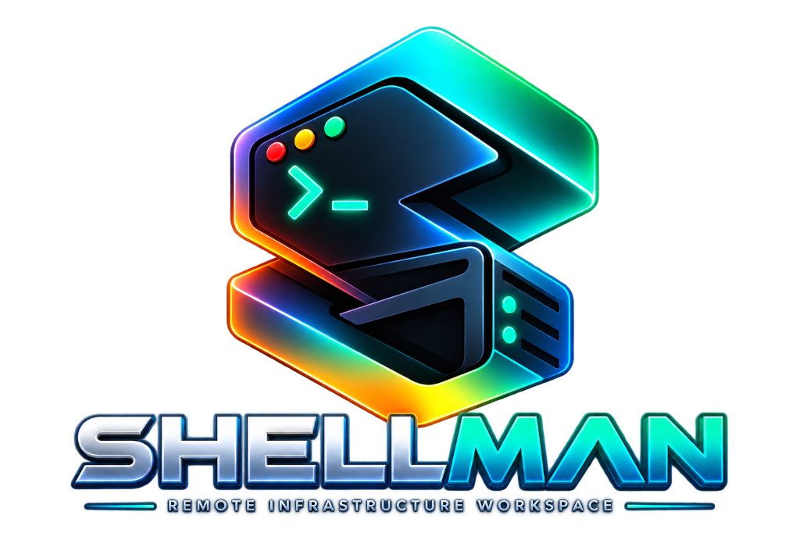
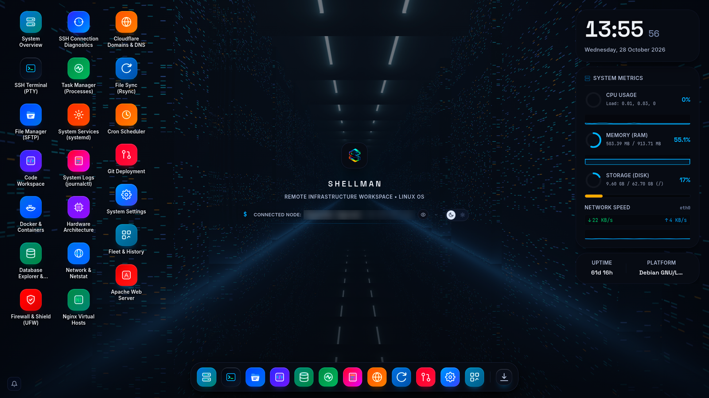
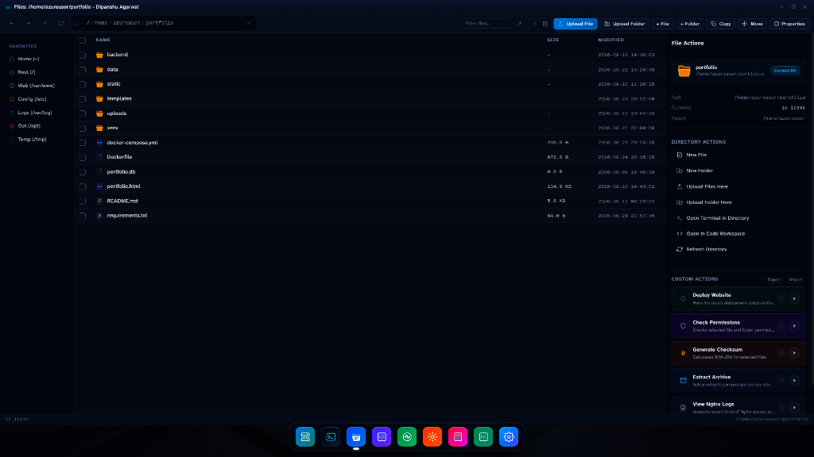
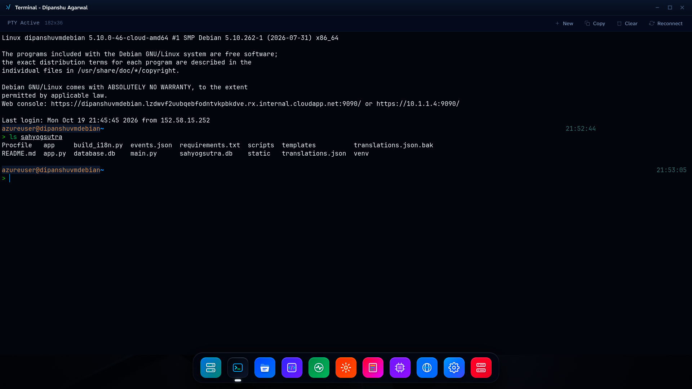
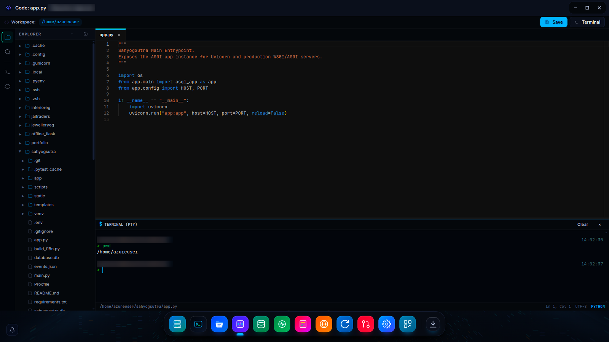
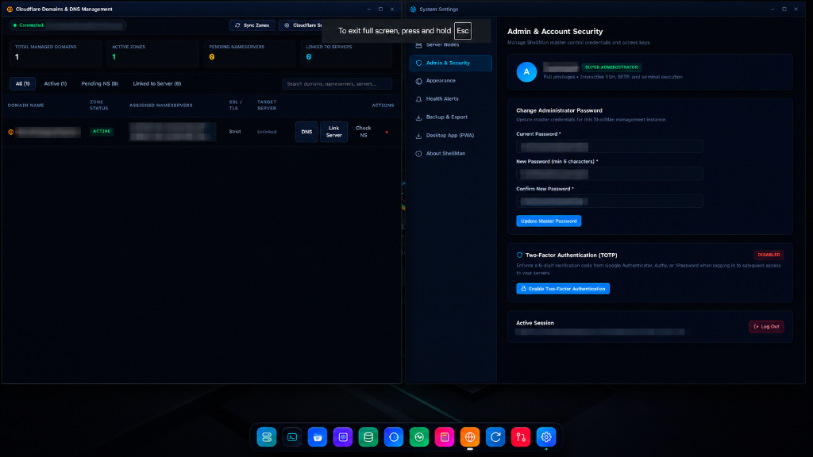
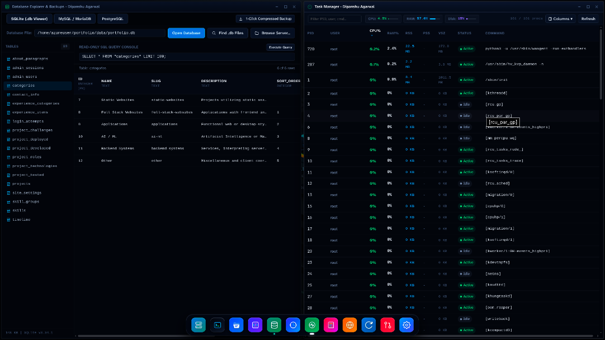
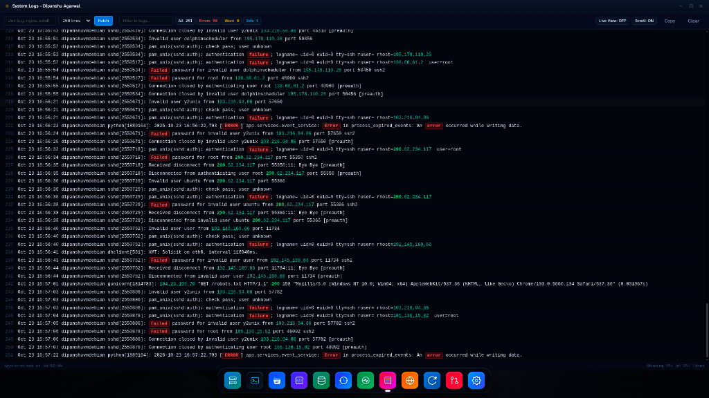
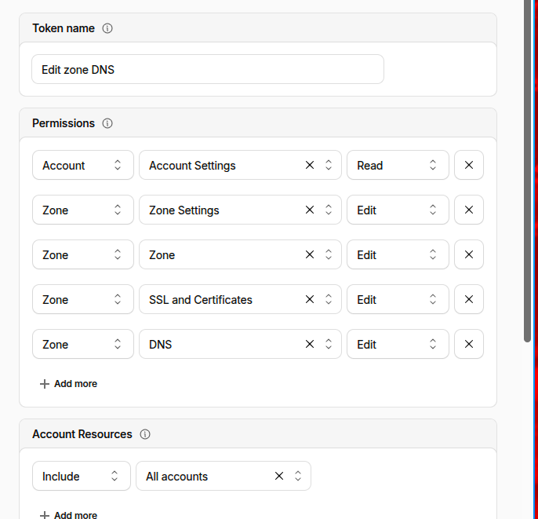

<p align="center">
  
</p>

<p align="center">
  <strong>The Agentless Linux Remote Infrastructure Workspace & Web Operating Environment</strong><br>
  <em>Manage all your Linux VPS, clouds, and bare-metal servers from your local machine with 0 MB resident RAM overhead.</em>
</p>

<p align="center">
  <a href="#the-story-why-shellman"></a>
  <a href="#option-a-1-command-docker-deployment-recommended"></a>
  <a href="#quick-start-guide"></a>
  <a href="#2-real-interactive-ssh-pty-terminal"></a>
  <a href="#3-sftp-file-manager-with-recursive-folder-drag-and-drop--custom-actions"></a>
  <a href="#6-real-time-task-manager--linux-process-control"></a>
  <a href="#8-nginx-web-server-reverse-proxy-routing--certbot-ssl"></a>
  <a href="#9-progressive-web-app-pwa-support"></a>
  <a href="#license"></a>
</p>

---

## The Story: Why ShellMan?

### Tired of Server Panels Eating Up Half Your VPS RAM?

Picture this: You spin up an affordable 1 GB or 2 GB Linux VPS for a project, database, or API service. You want an intuitive dashboard to monitor health, edit configuration files, inspect logs, and upload assets without typing twenty terminal commands for every minor change.

So you install a traditional server manager like cPanel, Plesk, Webmin, Cockpit, or aaPanel, and immediately encounter significant drawbacks:

- **Bloated Daemons Everywhere**: Node.js runtimes, heavy Python processes, background pollers, and custom web servers are installed directly onto your server.
- **400 MB to 800 MB RAM Consumed**: Before you have even deployed your application, half your server memory is consumed just running the management panel.
- **Expanded Attack Surfaces**: You are forced to expose non-standard inbound ports (`8080`, `2087`, `9090`) to the public internet, inviting port scanners and brute-force attempts.
- **Invasive Uninstalls**: Removing traditional panels often leaves behind stray packages, altered firewall rules, and broken system dependencies.

### The Solution: Run It On Your Machine

> **Why should your remote server waste compute running its own management UI when you have a powerful workstation in front of you?**

**ShellMan flips the architecture on its head.**

Instead of installing an invasive panel on remote servers, you run **ShellMan locally on your laptop, desktop, or private gateway**. ShellMan communicates with your Linux servers exclusively over standard, battle-tested **OpenSSH (Port 22) and SFTP**.

- **0 MB Persistent RAM on your servers**: Absolutely nothing is installed on your remote machines.
- **No background daemons**: No persistent monitoring daemons or cron jobs consuming remote CPU cycles.
- **No extra ports required**: If your server accepts standard SSH on port 22, ShellMan works out of the box.
- **Instant multi-node switching**: Manage staging boxes, production clusters, Raspberry Pis, and home labs from a single desktop interface.

Your remote servers dedicate **100% of their compute and memory to your workloads**.

---

## Technical Comparison: Traditional Panels vs. ShellMan

| Metric / Feature | Traditional Panels (cPanel, Webmin, Cockpit) | ShellMan |
| :--- | :--- | :--- |
| **Agent / Daemon Required on Target** | Yes (Persistent resident daemon) | **None (100% Agentless)** |
| **Managed Server RAM Overhead** | 300 MB - 800 MB | **0 MB (Zero resident footprint)** |
| **Inbound Firewall Ports Needed** | Custom open ports (`8080`, `9090`, etc.) | **Standard OpenSSH (Port 22 only)** |
| **Multi-Node Fleet Control** | Often requires paid multi-server licenses | **Built-in instant node switcher** |
| **File Transfer Experience** | Basic single-file HTML uploaders | **Recursive folder Drag & Drop via SFTP** |
| **Web Server & SSL Automation** | Manual CLI certbot or complex vhost edits | **1-click Reverse Proxy Routing, Certbot SSL automation, & safe syntax validation with auto-rollback** |
| **Custom Automations** | Hardcoded menus or complex plugins | **Extensible Custom Actions with safe POSIX variable injection & 33+ vector SVGs** |
| **Process & Task Management** | Coarse CPU list or heavy background poller | **Agentless POSIX control (SIGTERM, SIGKILL, SIGSTOP, SIGCONT) with RSS & PSS memory metrics** |
| **Terminal Capability** | Simulated web console | **Real interactive PTY with xterm.js (vim, htop, tmux)** |
| **Code Editing** | Plain textarea or basic editor | **Full Monaco Editor (VS Code engine)** |
| **Directory Sync & Backup** | Complex CLI syntax or absent | **Dual-Mode Agentless Rsync (Local &harr; Remote Push/Pull + Server Mirror) with dry-run diffs** |
| **Scheduled Jobs (Cron)** | Raw crontab text editing | **Visual Crontab Manager with human-readable scheduler & 1-click Run Now subshell tester** |
| **Git Deployment** | Manual terminal pulls | **Git Continuous Deployment with live commits log, branch tracking, & automated webhook triggers** |
| **Two-Factor Security** | Often absent or complex addon | **Native TOTP 2FA with pure SVG QR codes & emergency recovery backup codes** |
| **Interface Style** | Tab-heavy static web pages | **Fluid Multi-Window Web Desktop OS & PWA** |
| **Clean Exit** | Leaves packages, scripts, & config cruft | **Disconnect SSH and your server is completely untouched** |

---

## Visual Showcase

### 1. Modern Linux Desktop Operating Environment
> Atmospheric wallpaper, live system telemetry panel, application dock, and active connected node switcher with privacy IP masking.
<p align="center">
  
</p>

### 2. Remote SFTP File Manager with Recursive Drag-and-Drop & Custom Actions
> Dual-pane remote file browser with directory tree navigation, persistent resizable properties panel, recursive folder drag-and-drop, and an extensible Custom Actions engine with safe parameter interpolation and live terminal handoff.
<p align="center">
  
</p>

### 3. Authentic Interactive SSH PTY Terminal
> Low-latency WebSockets streaming xterm.js PTY directly connected to remote Linux instances with full curses navigation.
<p align="center">
  
</p>

### 4. Monaco Code Workspace (VS Code Engine) with Integrated Terminal
> Full remote IDE with multi-tab workspace, folder tree explorer, context menu operations, syntax highlighting, instant asynchronous SFTP save, and built-in interactive PTY shell.
<p align="center">
  
</p>

### 5. Cloudflare DNS Management & System Security Settings
> Multi-window desktop workflow featuring full Cloudflare zone & DNS record orchestration alongside native TOTP 2FA authentication, active session controls, and administrative security.
<p align="center">
  
</p>

### 6. Database Explorer (.db / SQLite / MySQL / Postgres) & Task Manager
> Agentless database explorer with table viewer, live SELECT query console, 1-click compressed backups, and real-time process monitoring with CPU/RAM metrics.
<p align="center">
  
</p>

### 7. Real-Time Journalctl System Log Streamer & Analyzer
> Streaming Linux system logs with automatic error/failure badge highlighting, log level filters, IP address detection, and regex keyword searching.
<p align="center">
  
</p>

---

## Key Features

### 1. Multi-Window Desktop Workspace & Window Snapping
- **True Desktop Experience**: Open multiple applications side-by-side. Move, resize, minimize to dock, maximize, and cascade windows smoothly.
- **Drag-and-Drop Aero Window Snapping**: Drag any window to the left or right edge of the screen to snap to 50% viewport width, or drag to the top edge to maximize. Displays a translucent glassmorphism snap preview overlay with smooth restore on drag release.
- **Interactive Application Dock**: Launch and switch between Overview, Terminal, File Manager, Code Workspace, Task Manager, Nginx & Domains Manager, Services, Logs, Rsync Sync, Cron Scheduler, Git Deployments, and Settings.
- **Central Node Switcher**: Seamlessly switch active servers with one click.
- **Unified Command Palette (Ctrl+K)**: Instant search across desktop apps, registered server nodes, and remote server files over SFTP. Typing a filename (e.g. `nginx.conf`) searches the host and opens it directly in Monaco Code Workspace.
- **Privacy IP Masking Toggle**: Sensitive server IP addresses are masked by default (`20.219.2***:22`). Click the inline eye icon SVG to reveal or hide unmasked host endpoints instantly.
- **Persistent Preferences**: Wallpapers, window geometry, and privacy settings persist in local browser storage.

### 2. Real Interactive SSH PTY Terminal
- **True Pseudo-Terminal (PTY)**: Backed by Paramiko `invoke_shell(term='xterm-256color')` streamed over low-latency WebSockets directly to `xterm.js`.
- **Multiple Color Themes**: Choose from 16 curated developer color schemes: **ShellMan Cyberpunk (Default)**, **Dracula**, **One Dark**, **Nord Frost**, **Tokyo Night**, **Catppuccin Mocha**, **Gruvbox Dark**, **Synthwave '84**, **Solarized Dark**, **Solarized Light**, **Material Ocean**, **Cobalt2**, **GitHub Dark**, **Night Owl**, **Monokai Pro**, and **The Matrix Green**. Switch themes on the fly from the terminal toolbar or globally in System Settings, automatically applying to all active terminals and integrated consoles.
- **Full Curses & Terminal App Support**: Effortlessly run `htop`, `vim`, `nano`, `tmux`, `less`, `tail -f`, and interactive REPLs with zero input lag.
- **Signal Handling**: Dedicated raw input interception handles <kbd>Ctrl</kbd>+<kbd>C</kbd>, <kbd>Ctrl</kbd>+<kbd>D</kbd>, <kbd>Ctrl</kbd>+<kbd>Z</kbd>, <kbd>Ctrl</kbd>+<kbd>L</kbd>, and arrow keys without browser collision.
- **Dynamic Viewport Auto-Fit**: Window resizes trigger real-time PTY terminal column and row recalculations via `fitAddon`.

### 3. SFTP File Manager with Recursive Folder Drag-and-Drop & Custom Actions
- **Custom Actions Automation Engine**: Turn recurring shell commands into reusable remote buttons directly embedded in the file manager.
  - **Safe POSIX Parameter Substitution**: Variables are safely quoted and escaped to prevent command injection: `{{selected_path}}`, `{{selected_name}}`, `{{current_dir}}`, `{{selected_paths}}`, and `{{server_name}}`.
  - **Embedded Output Panel & Terminal Handoff**: Run actions with live status badges, exit code tracking, stdout/stderr output streaming, rerun button, and a 1-click terminal handoff to continue interactively.
  - **Confirmation Shield**: Optional confirmation dialog displaying the target server, selected remote paths, and exact command preview before execution.
  - **Extensive Vector Icon Library**: Searchable 3-column palette featuring 33+ clean vector SVG icons tailored for Linux administration (Deploy, Run, Shield, Lock, Key, Checksum, Archive, Logs, Database, Server, CPU, Cloud, Download, Upload, Restart, Trash, Wrench, Zap, Search, Alert, Code, Backup, Network, Health, Release, Git, Container, Web, Link, Config).
  - **Export & Import**: Share custom actions between servers and teammates via standardized JSON export/import.
- **Persistent Drag-to-Resize Properties Drawer**: An interactive vertical split handle allows dragging the right-side properties panel from 220px to 750px. Width persists in local storage across browser reloads. Double-click the handle to restore default width.
- **Recursive Folder Drag-and-Drop**: Drag entire directory hierarchies from your local workstation directly into the browser — ShellMan automatically creates remote folders recursively (`mkdir -p`) and uploads all nested files.
- **Target Folder Hover Detection**: Hover dropped files directly over a target folder row or grid tile to upload straight into that subdirectory.
- **Dual View Modes & Batch Operations**: Switch between a compact details list and a responsive thumbnail grid. Inspect permissions (`chmod`), ownership (`chown`), file sizes, and timestamps. Batch move, copy, compress (`.zip`/`.tar.gz`), and delete items.

### 4. Monaco Code Workspace (VS Code Engine)
- **Full-Fledged Editor**: Powered by Microsoft Monaco with syntax highlighting, bracket matching, line numbers, and multi-cursor support.
- **Local File Drag & Drop Integration**: Drag any file directly from your local desktop onto the editor viewport to immediately open it in an editable tab. Press <kbd>Ctrl</kbd>+<kbd>S</kbd> to save and upload it directly to the remote server workspace. Dragging files onto the left explorer tree immediately saves them to the active folder and refreshes the directory hierarchy.
- **Desktop-Grade Right-Click Context Menus**: Full context menu suite on explorer files and folders (New File, New Folder, Rename, Duplicate/Copy, Move with Remote Directory Picker, Open in Terminal, Download, Copy Absolute/Relative Path, Delete) and editor tabs (Close, Close Others, Close All, Save, Copy Path).
- **Broad Language Support**: Python, JavaScript, TypeScript, Shell Script, Dockerfile, Nginx config, JSON, YAML, HTML, CSS, SQL, and Markdown.
- **Integrated Terminal Panel**: Collapsible bottom PTY terminal panel synchronized with the active workspace directory for seamless test and build cycles.
- **Fast Remote Editing**: Hotkeys for Quick Open (<kbd>Ctrl</kbd>+<kbd>P</kbd>) and instant asynchronous SFTP remote save (<kbd>Ctrl</kbd>+<kbd>S</kbd>).

### 5. Live Telemetry & Resource Hub
- **Hardware Telemetry**: Real-time dials for CPU usage %, RAM distribution (Used / Total), swap memory, and load averages (1m, 5m, 15m).
- **Disk Partition Mounts**: Visual usage meters for root (`/`), boot mounts, and external drives.
- **OS & Kernel Specs**: Linux distribution detection, kernel release, uptime counter, and CPU architecture.

### 6. Real-Time Task Manager & Linux Process Control
- **Agentless Process Telemetry (0 MB Resident Daemon)**: Reads process statistics directly via standard OpenSSH using `/proc` and `ps -eo` inspection — requiring zero agent daemons or background workers on remote servers.
- **Multi-Metric Memory Footprint (RSS, PSS, VSZ & RAM%)**:
  - **RSS (Resident Set Size)**: Physical RAM allocated to the process.
  - **PSS (Proportional Set Size)**: Private memory plus proportional share of shared libraries (`/proc/[pid]/smaps_rollup`), revealing true individual memory weight.
  - **VSZ (Virtual Size)**: Total virtual memory address space.
  - **RAM%**: Formatted alongside exact memory footprint (e.g. `45.2 MB (2.3%)`).
- **Decoded Linux Process State Engine**: Automatically translates Linux `STAT` codes into human-readable states with color-coded badges and explanatory tooltips:
  - `Running` (`R`): Actively executing instructions on CPU.
  - `Active` (`S`): Healthy process sleeping and waiting for incoming events or network requests.
  - `Disk Wait` (`D`): Uninterruptible sleep awaiting disk or hardware I/O.
  - `Zombie` (`Z`): Defunct process terminated but not yet reaped by its parent.
  - `Stopped` (`T` / `t`): Paused by job control signals or an active debugger.
  - `Idle` (`I`): Idle kernel worker thread.
  - Modifiers: High priority (`<`), Nice low priority (`N`), Locked memory pages (`L`), Session leader (`s`), Multi-threaded (`l`), Foreground process (`+`).
- **Full POSIX Signal Dispatch**: Right-click or menu actions for instant signal delivery:
  - `SIGTERM (15)`: Request clean, graceful application shutdown.
  - `SIGKILL (-9)`: Immediate forced termination for unkillable or frozen tasks.
  - `SIGSTOP (19)`: Pause / freeze execution without losing process memory.
  - `SIGCONT (18)`: Resume paused execution.
  - Quick Copy: 1-click clipboard copy for PID and complete command line arguments.
- **Host Telemetry Bar**: Integrated header meters displaying live host-wide CPU %, RAM %, and root partition disk % with animated capacity bars.
- **Column Customization & Instant Filtering**: Select visible columns with localStorage persistence. Filter instantly across PID, username, command name, and argument flags. Sort columns ascending or descending with one click.

### 7. System Services, Journalctl Logs & Live Viewer
- **Systemd Unit Control**: Inspect all service states (`active`, `running`, `failed`, `inactive`) with one-click Start, Stop, and Restart actions.
- **Regex Syntax Highlighting**: Journal and system logs are rendered with color-coded syntax formatting: errors (`red`), warnings (`amber`), notice/info (`cyan`), debug (`gray`), IPv4/IPv6 addresses (`blue`), and HTTP status codes.
- **Continuous Live View Streaming**: Real-time streaming toggle (`Live View: ON/OFF`) polls and streams incoming system log entries continuously into the terminal view without requiring manual refreshes or reopening the window.
- **Severity Counters & In-Log Filtering**: Live count pills for Total, Errors, Warnings, and Info lines, coupled with instant regex search filtering.

### 8. Nginx Web Server, Reverse Proxy Routing & Certbot SSL
- **Reverse Proxy Domain Routing**: Route public domains and subdomains to internal backend services and microservices running on local ports (Node.js, Python/Flask/FastAPI, Next.js, Go, or Docker containers).
- **Automated Let's Encrypt SSL via Certbot**: 1-click HTTPS certificate issuance and renewals via Certbot and the Certbot Nginx plugin, with automated HTTP-to-HTTPS redirect rule generation.
- **Virtual Host Manager**: Create, enable, disable, and delete virtual host configurations (`/etc/nginx/sites-available` and `/etc/nginx/sites-enabled`) with automated symlink management.
- **Safe Configuration Editor with Auto-Rollback**: Inspect and modify `/etc/nginx/nginx.conf` and site configs inside an embedded editor. Every save is pre-flight tested using `nginx -t`. If validation fails, changes are instantly rolled back to the backup copy to prevent service downtime.
- **Service Controls**: One-click configuration reload (`nginx -s reload`), service restart, syntax testing, and native package installer for Nginx and Certbot across Debian, Ubuntu, RHEL/CentOS, and Arch Linux.

### 9. Cloudflare Domains & Authoritative DNS Management
- **Operator-Level Cloudflare Integration**: Connect your personal Cloudflare account once using a minimum-privilege scoped API token. No SaaS multi-tenant overhead or third-party credential exposure.
- **Fernet Encrypted Secret Storage**: The Cloudflare API token is encrypted at rest using local per-installation Fernet keys (`0600` permissions) and is never transmitted in browser API responses, HTML, logs, or diagnostic outputs.
- **Unified Domain Dashboard**: View domain zones, Cloudflare activation state (`active`, `pending`, `error`), assigned authoritative nameservers, SSL/TLS encryption mode, DNSSEC status, and associated ShellMan server node.
- **Cloudflare Origin CA Certificate Generator (15-Year Validity)**:
  - Generates RSA 2048-bit private keys locally and signs standard PEM-encoded Certificate Signing Requests (CSR) with domain and wildcard Subject Alternative Names (SANs).
  - Issues official 15-year certificates via Cloudflare's `/certificates` API.
  - **1-Click Server Installation**: Deploys certificate and private key directly to `/etc/nginx/ssl/{domain}.crt` and `/etc/nginx/ssl/{domain}.key` via SSH, verifies permissions (`0644` / `0600`), and runs automated `nginx -t` syntax validation.
  - Completely eliminates 90-day Let's Encrypt renewal failures behind proxied domains.
- **1-Click Edge Cache Purge**: Instant **Purge Everything** for global cache invalidation upon deployments, or **Purge by URL / Prefix** to invalidate specific stylesheets, scripts, or assets.
- **Development Mode Toggle**: Temporarily bypasses Cloudflare edge cache for 3 hours with a live visual countdown timer, ensuring HTML, CSS, and JS edits in ShellMan's Monaco editor reflect immediately in the browser.
- **1-Click "Under Attack Mode"**: Enables Cloudflare edge JavaScript challenge during incoming floods or high `SYN_RECV` states detected in the Live Netstat/DDoS monitor, absorbing malicious traffic before it reaches origin server resources.
- **24-Hour Traffic Ticker & Telemetry**: Visual edge metrics showing Total Requests, Unique Visitors, Cached vs Uncached bandwidth, and Blocked Threat count.
- **Export RFC 1035 BIND Zone File**: 1-click download of all DNS records formatted in standard RFC 1035 / BIND format (`.txt`) for emergency offline backups or provider migrations.
- **Add Domain Workflow**: Add domains to Cloudflare with immediate retrieval of assigned nameservers, 1-click individual and bulk copy buttons, registrar update guidelines, and mail record disruption warnings.
- **Full DNS Record Manager**: Add, edit, search, and delete records across all major record types: `A`, `AAAA`, `CNAME`, `MX`, `TXT`, `NS`, `SRV`, and `CAA`.
  - **Cloudflare Proxy Toggle**: 1-click toggle for Cloudflare edge proxying (CDN, WAF, DDoS protection) on eligible record types (`A`, `AAAA`, `CNAME`).
  - **Granular TTL & Priority Controls**: Configure TTL from Automatic down to 1 minute, with priority inputs for `MX` and `SRV`.
- **Domain-to-Server Linkage**: Connect root `@` or subdomains directly to any ShellMan server IP.
  - **Private IP Guard**: Detects RFC 1918 / loopback / link-local addresses and warns if a private IP is about to be exposed publicly.
  - **DNS Conflict Detection**: Detects if an existing record points to a different IP and requires explicit confirmation before overwriting.
  - **Nginx & SSL Handoff**: 1-click transition to Nginx virtual host configuration and Origin CA HTTPS certificate provisioning.
- **Live Diagnostics & Reachability Probe**: Probes public DNS resolution, validates origin IP matching, checks HTTP/HTTPS status, and verifies SSL certificate presence.

### 10. Live Netstat & DDoS Socket Monitor
- **Interactive Active Socket Telemetry**: Displays all live TCP and UDP connections with protocol, connection state, local socket, remote foreign IP, and process/program names via standard `ss` / `netstat`.
- **DDoS Activity Leaderboard**: Automatically aggregates and ranks remote IP addresses by total concurrent socket count and SYN_RECV state, giving immediate visibility into traffic spikes, port scans, and SYN flood attacks.
- **State Breakdown**: Instant metric counters for Total Active, Established, SYN_RECV, and Time Wait sockets.
- **Interactive Filtering & Auto-Refresh**: Real-time search across IP, port, or process, state filter dropdown (`ESTABLISHED`, `SYN_RECV`, `TIME_WAIT`, `CLOSE_WAIT`), 1-click IP copy, and configurable live polling intervals (`3s`, `5s`, `10s`, or paused).

### 11. Progressive Web App (PWA) Support
- **Installable Desktop App**: Install ShellMan as a native desktop application in Chrome, Brave, Edge, or Safari with custom window controls overlay.
- **Distraction-Free**: Runs in standalone mode without browser tabs, address bars, or extension clutter.

### 12. Two-Factor Authentication (2FA / TOTP)
- **Time-Based One-Time Passwords (TOTP)**: Protect master administrator access using standard authenticator apps (Google Authenticator, Authy, 1Password, Bitwarden).
- **Pure Vector QR Code**: High-contrast SVG QR barcode generated dynamically without raster image dependencies.
- **Emergency Recovery Backup Codes**: Generates 8 one-time alphanumeric backup recovery codes (`XXXX-XXXX`) during 2FA activation with a 1-click copy/download modal to prevent lockouts.
- **Dedicated Recovery Flow**: Login prompt includes an alternative "Use a backup code instead" option that validates single-use codes seamlessly with or without dashes.
- **Safe 2FA Deactivation**: Requires entering the current master administrator password to disable 2FA, preventing unauthorized deactivations.

### 13. Configuration Backup & Migration (Export / Import)
- **Unified JSON Portability**: Export your complete ShellMan setup into a single portable `.json` archive.
- **Credential Sanitization**: Server nodes are exported with passwords and private keys stripped, making backups safe to share or store.
- **Seamless Restore**: Import restores custom automation actions, server nodes, and visual preferences (`theme`, `wallpaper`, `font-size`) across machines.

### 14. Server Health Monitoring & Configurable Alerts
- **Configurable Resource Thresholds**: Customize exact trigger thresholds for **CPU Utilization** (e.g. 60% to 95%) and **RAM Utilization** (e.g. 60% to 95%) with custom value inputs.
- **Sustained Duration Filter**: Set minimum duration (1 to 10 minutes) before an alert fires to eliminate false alarms from transient compilation or backup spikes.
- **Node Outage Detection**: Automatically alerts when a host fails 3 consecutive telemetry polls (~15s) and dispatches recovery notices upon reconnection.
- **Dual Delivery Channels**: Real-time glassmorphism in-app toast banners plus native OS push notifications via Web Notifications API / PWA. Includes a test alert dispatcher.

### 15. Agentless File Sync (Rsync over SSH)
- **Dual Sync Engine**:
  - **Mode 1: Local &harr; Remote Sync**: Transfer and synchronize folders directly between your local workstation running ShellMan and the remote server over SSH:
    - **Push (`Local &rarr; Remote Server`)**: Uploads and synchronizes local project directories to remote server destinations.
    - **Pull (`Remote Server &rarr; Local`)**: Downloads and mirrors remote directories to your local machine.
    - **Zero-Dependency SSH Auth**: Uses POSIX `SSH_ASKPASS` and temporary key permissions (`chmod 0600`) — fully supporting both password and private key authentication without needing `sshpass`.
  - **Mode 2: Server Backup & Mirror**: Direct server-side directory replication (e.g., `/var/www/` &rarr; `/var/backups/www/`) executed entirely on the remote host via the persistent SSH session without pulling data over your local connection.
- **Interactive Directory Browser (Local & Remote)**: Built-in modal directory picker supporting both remote server SFTP and local workstation filesystems with breadcrumb navigation, double-click traversal, quick presets (`~/`, `~/Projects`, `~/Documents`, `/var/www/`, `/opt/`, `/etc/`), and real-time directory creation (`+ New Folder`).
- **Safe Dry-Run Preview (`-n`)**: Evaluates transfer operations beforehand, presenting the exact files to be synchronized, total files count, and byte statistics before applying changes.
- **Flexible Options**: Toggle Archive mode (`-a`), network stream compression (`-z`), and exact mirror deletion (`--delete`).
- **Exclude Pattern Filters**: Ignore build artifacts and cache folders (`.git`, `node_modules`, `__pycache__`, `*.tmp`, `.DS_Store`).
- **Live Output Stream**: Formatted terminal output pane with status badges (`IDLE`, `ANALYZING`, `PREVIEW OK`, `SYNCING`, `SUCCESS`, `FAILED`) and exit code tracking.

### 16. Cron Job Manager (Scheduler)
- **Visual Crontab Manager**: Inspect, add, edit, toggle, and delete scheduled cron entries on remote servers without manual terminal editing.
- **Human-Readable Decoder**: Automatically translates raw cron syntax (`0 2 * * *`) into plain English descriptions ("Daily at 02:00").
- **Schedule Presets**: 1-click presets for Hourly, Daily, Weekly, Monthly, Every 5/15 Minutes, and System Startup (`@reboot`).
- **Immediate Execution Tester**: "Run Now" action executes any scheduled cron command in a subshell over SSH and displays stdout/stderr output immediately.
- **Native 38px Utility Toolbar**: Integrated live search filter, schedule badges, and clean vector SVG icons.

### 17. Git Continuous Deployment & Webhooks
- **Repository Linking**: Link Git repositories to any server directory with branch tracking (`main`, `master`, `staging`) and interactive SFTP Directory Picker support.
- **Live Git Inspection**: Inspect real-time branch status, remote origin URL, working tree clean/dirty state, and recent commit history (hash, author, relative time, message).
- **1-Click Pull Latest**: Pull updates and automatically execute post-deployment commands (e.g. `npm install && npm run build` or `systemctl reload nginx`).
- **Automated Deployment Webhooks**: Generates unique webhook URLs (`POST /api/deploy/webhook/<token>`) for GitHub and GitLab to automate deployment on `git push`.
- **Native 38px Utility Toolbar**: Filter across deployments, status badges, and deployment logs.

### 18. Docker & Container Manager
- **100% Agentless Container Discovery**: Inspects Docker engine and active/stopped containers over standard SSH via `docker ps -a --format '{{json .}}'` with 0 MB resident RAM overhead.
- **Full Lifecycle Operations**: 1-click Start, Graceful Stop (`-t 10`), Restart, Pause, and Forced Remove (`rm -f`).
- **Live Container Log Streaming**: Tail and stream container logs directly into an interactive modal viewer with syntax formatting, timestamps, search filter, and clipboard copy.
- **Docker Compose Automation**: Execute `docker compose up -d --build`, `down`, and `restart` in remote directories with custom compose file paths.
- **Performance Telemetry**: Inspect non-streaming container CPU %, Memory usage, and Network I/O metrics on demand.

### 19. Database Explorer & Backups (SQLite .db Viewer, MySQL, PostgreSQL)
- **Interactive SQLite .db / .sqlite File Viewer**:
  - Open and inspect any remote SQLite database file directly from the SFTP File Manager (double-click integration) or path input.
  - Automatic table schema viewer (`PRAGMA table_info`), primary key badges, and column data types.
  - Paginated row browser with responsive data grid.
  - Safe read-only SQL console: executes custom `SELECT`, `PRAGMA`, and `EXPLAIN` queries while blocking mutations (`INSERT`, `UPDATE`, `DELETE`, `DROP`, `ALTER`).
  - Auto-Discovery: 1-click scanner searches `/var/www`, `/home`, and `/opt` to locate SQLite database files automatically.
- **MySQL & MariaDB Explorer**: Connects via local Unix socket without exposing ports, browse databases and tables, and preview rows.
- **PostgreSQL Explorer**: Connects using peer authentication, lists active databases and public schema tables.
- **1-Click Compressed Dump Generator**: Creates compressed backups (`.db.gz` or `.sql.gz`) in `/tmp/` ready for immediate SFTP retrieval.

### 20. Firewall (UFW) & Fail2Ban Security Shield
- **Visual UFW Firewall Control**: Real-time status display (`Active` / `Inactive`), default traffic policy readout, and numbered rule table.
- **Rule Management**: Add allow/deny/limit rules for ports and specific IP addresses; delete rules with 1-click confirmation.
- **Fail2Ban Jail Inspector**: Queries active intrusion jails (e.g. `sshd`), lists currently banned malicious IPs, and offers 1-click unban.
- **DDoS Monitor Integration**: Connected directly with the Live Netstat & DDoS socket monitor. Click "Ban" next to any abusive foreign IP to immediately block it at firewall rule position 1 (`sudo ufw insert 1 deny from <ip> to any`).

### 21. SSH Connection Diagnostics Dashboard ("The Secret Weapon")
- **Encrypted Transport Verification**: Proves raw SSH transport authenticity directly in the UI.
- **Live Round-Trip Latency (RTT)**: High-precision ping measured in milliseconds via OpenSSH keepalive global requests without spawning shell subshells.
- **Cryptographic Cipher Breakdown**: Active symmetric bulk cipher (e.g., `chacha20-poly1305@openssh.com`, `aes256-gcm`), Key Exchange engine (`curve25519-sha256`), and MAC digest.
- **Strict KEX & Anti-Terrapin Verification**: Displays whether strict key exchange negotiation is active.
- **Host Key SHA-256 Fingerprint**: Instant fingerprint inspection and 1-click clipboard copy.
- **Socket & Protocol Banners**: Displays remote OpenSSH banner, client banner, socket endpoint, and SFTP subsystem pool status.

### 22. Desktop Customizer & Real Application Dock
- **Customize Desktop & Dock**: Right-click any desktop icon or dock item and choose *Customize Desktop & Dock...* to choose which of the 19 registered apps appear as desktop shortcuts and which are pinned to the dock. Reset to defaults at any time.
- **Running Apps Appear in the Dock**: An app that is open but not pinned shows up after a separator, like a native dock. Minimized apps stay there, dim, with a hollow running indicator. Click to restore, or right-click and choose **Keep in Dock** to pin it permanently.
- **Dock Context Menu**: Open, Add to / Remove from Desktop, Unpin from Dock, Close window (or Close all windows when several are open), Customize, and Hide Dock. The hidden state persists across reloads.
- **Desktop Icon Sizes**: Compact, Normal, or Large. Icons wrap into new columns instead of hiding, auto-scale to fit the free area beside the widgets, and show app names on up to two lines.
- **Hardware App**: CPU cores, RAM layout, storage block devices, and `lshw` topology. It is available as a desktop shortcut and can be pinned to the dock.

### 23. Appearance, Themes & Wallpaper
- **Accent Colors**: Cyan, Violet, Emerald, Rose, or Amber. The accent drives active windows, dock indicators, gauges, buttons, and the node prompt.
- **Font Scale**: A slider from 12 to 24 px with a live preview.
- **15 Terminal Themes**: ShellMan Cyberpunk, Dracula, One Dark, Nord Frost, Tokyo Night, Catppuccin Mocha, Gruvbox Dark, Solarized Dark and Light, Material Ocean, Cobalt2, GitHub Dark, Night Owl, Monokai Pro, and The Matrix Green. One setting applies to the SSH terminal and the Code Workspace terminal.
- **Wallpaper**: Use the built-in 8K wallpaper with one-click reset. The choice persists locally and is included in Backup & Export preferences.

### 24. Live Desktop Widgets & Responsive Layout
- **Widgets Panel**: Clock (with a server time zone label), live CPU, RAM, and disk gauges (click to open System Overview), and an uptime and platform card. All of it follows the active node.
- **`$` Prompt Node Switcher**: The active node is shown as a shell prompt (`$ Connected Node`, name, `user@host`). `$` is accent coloured when the node is reachable and grey when it is offline. Every status marker in the app uses the same `$`. Offline nodes are dimmed in the switcher list.
- **Adapts to Any Screen**: Layouts for ultrawide, laptop, tablet, and phone. On phones the widgets stack, the node pill centres, and the dock and icon grid stay usable. Pages outside the desktop (system bar and node modal) share the same design.
- **Installable & Persistent**: Window geometry, dock, icon size, accent, font scale, and terminal theme persist in browser storage.

### 26. Server-Side Alerts & Notification Channels
- **Runs Without a Browser**: A background engine checks every node on a fixed interval (`SHELLMAN_ALERT_INTERVAL`, default 60 s), so alerts fire even when no ShellMan tab is open. Set `SHELLMAN_ALERTS=0` to disable it. A file lock (`.alerts.lock`) ensures only one gunicorn worker runs the engine.
- **Rules**: Presets for node offline, CPU, RAM, disk, load and more, each with a threshold, a sustained duration, a severity and a cooldown. An alert fires after consecutive breaches, resolves after two clean checks, and re-notifies only after the cooldown. Open incidents survive restarts.
- **Channels**: Telegram, Slack, Discord, generic webhook (optional HMAC signature in `X-ShellMan-Signature`) and email (SMTP). Every channel has a Test button. Secrets are stored encrypted and never returned to the browser.
- **Safe Outgoing Requests**: Webhook URLs must be http or https, link-local and cloud metadata addresses are blocked, and redirects are not followed.
- **In-App Bell**: A notification bell shows open incidents with acknowledge, acknowledge-all and clear actions.

### 27. Audit Log
- **What Is Recorded**: Logins (success, failure, lockout, 2FA), password and 2FA changes, server add/edit/delete, terminal sessions, file writes and deletes, git and system actions, automation runs, backup export/import and alert changes. Each entry stores time, user, IP, action, target and result.
- **Viewer and Export**: Settings → Audit Log filters by action, user and result, and exports CSV (formula-injection safe).
- **Filters**: Search text, user, failures only, and a From/To date range with quick buttons (Today, 7 days, 30 days, All time). CSV export uses the same filters.
- **Retention**: Settings → Audit Log → Retention & cleanup sets how many days to keep (default 180) and a maximum entry count (default 20,000). 0 means no limit. Cleanup runs at startup, at least hourly while the log is written, and on Save. You can also delete by age, by the selected date range, or everything; the purge itself is recorded. Writing the log never breaks the action being logged.

### 28. Encrypted Full Backup & Restore
- **One File**: `Settings → Backup → Encrypted full backup` creates a `.smbak` file with servers (including saved passwords and keys), actions, alert rules and channels, and preferences.
- **Passphrase Encryption**: The file is encrypted with Fernet, using a key derived from your passphrase by PBKDF2-HMAC-SHA256 (600,000 iterations). Without the passphrase it cannot be read. A lost passphrase cannot be recovered.
- **Restore**: Import asks for the passphrase and merges into the current install. A wrong passphrase changes nothing. Imported actions always require confirmation before they run.

### 29. Lightweight SQLite Data Layer
- **Standard-library only**: ShellMan talks to SQLite through Python's built-in `sqlite3`, with a small data layer in `models/orm.py` instead of SQLAlchemy. This saves about 20 MB of RAM and two dependencies, and existing databases open unchanged (same tables, columns and date format).
- **Easy queries**: models read like before. `Server.query.get_or_404(3)`, `Server.query.filter_by(host=h).first()`, `AlertEvent.query.filter(AlertEvent.resolved_at.is_(None)).order_by(AlertEvent.id.desc()).all()`, `.count()`, `.update({...})`, `.delete()`. Changes to loaded objects are saved by `db.session.commit()`.
- **Raw SQL when needed**: `db.rows(sql, params)`, `db.scalar(sql, params)` and `db.isolated(sql, params)` (own connection, used by the audit log). Parameters are always passed separately, never formatted into the SQL text.
- **Safe under load**: one connection and one session per thread, writes use `BEGIN IMMEDIATE` with a 15 s busy timeout, and each request ends with a rollback of anything uncommitted.
- **Adding a model**: subclass `db.Model`, declare `db.Column(...)` fields and import it in `app.py`; `db.create_all()` creates the table. Adding a column to an existing table: call `db.add_column_if_missing(table, column, ddl)` in the start-up migration block.

### 25. Extra Editing & File Shortcuts
- **Search in Files**: The Code Workspace has a sidebar search across the opened workspace folder (`/workspace/search-code`).
- **File Manager Keyboard Control**: Navigate, rename, and delete from the keyboard (see the shortcut table below).
- **Smart Compress (.zip / .tar.gz / .tar)**: The Compress dialog can skip everything listed in `.gitignore` (root and nested files), lets you untick individual files and folders with checkboxes, offers quick-exclude chips (`node_modules`, `.git`, `__pycache__`, `.venv`, `.env`, `*.log`, build folders, IDE folders), and accepts custom patterns. Works without git installed on the server.
- **Everything Is Cancellable**: Closing a window, or pressing ×, Cancel or Esc on any dialog, aborts every request it started and kills the matching job on the server (compress, copy, move, extract, rsync, git, docker, certbot, database queries and so on), so nothing keeps the SSH connection busy. Any operation running longer than 2 seconds appears in a **Running** panel with its own cancel button. Progress toasts have a × as well.
- **Batch Operations**: Archive, extract, copy, move, chmod, and delete several selected items in one action.

---

---

## Quick Start Guide

### Option A: 1-Command Docker Deployment (Recommended)

Run ShellMan with a single Docker command. All encryption keys, server credentials, and SQLite state are persisted in the `shellman_data` volume:

```bash
docker run -d \
  -p 9874:9874 \
  -v shellman_data:/app/instance \
  --name shellman \
  --restart unless-stopped \
  dipanshu0919/shellman
```

Navigate to `http://localhost:9874` to access your environment.

### Option B: Docker Compose

Clone the repository and run via Docker Compose:

```bash
git clone https://github.com/Dipanshu0919/ShellMan.git
cd ShellMan

docker compose up -d
```

To view live container logs:
```bash
docker compose logs -f
```

### Option C: Native Python Environment

#### 1. Requirements
- **Python 3.9+**
- Standard Linux, macOS, or Windows (WSL recommended) environment
- `openssh-client` and `rsync`

#### 2. Setup & Installation

```bash
# 1. Clone the repository
git clone https://github.com/Dipanshu0919/ShellMan.git
cd ShellMan

# 2. Create virtual environment
python3 -m venv venv
source venv/bin/activate

# 3. Install dependencies
pip install -r requirements.txt

# 4. Launch ShellMan
python3 app.py
```

Open your browser and navigate to:
```text
http://127.0.0.1:9874
```

### First-Time Setup Wizard (No Default Credentials)
> [!IMPORTANT]
> **ShellMan does not ship with insecure default passwords.**
> On your very first visit, you will automatically be directed to the **First-Time Setup Wizard** (`/setup`) where you create your master administrator username and secure password. Once created, the wizard locks permanently and launches you directly into your desktop environment.

---

## Deploying a Public Live Demo Instance

To deploy a live read-only or sandbox demonstration of ShellMan for colleagues or the community (e.g. on Render, Railway, Fly.io, or an entry-tier VPS):

1. **Deploy Container**: Point your host's Docker or Git deployment pipeline to this repository.
2. **Environment Variables**:
   ```ini
   HOST=0.0.0.0
   PORT=9874
   # Optional: a random key is generated and stored in /app/instance if this is unset.
   # SHELLMAN_SECRET_KEY=<at least 16 random characters>
   SHELLMAN_COOKIE_SECURE=1
   SHELLMAN_TRUST_PROXY=1
   ```
3. **Persistent Volume**: Attach a persistent disk mount to `/app/instance` to retain the initialized demo account and sample sandbox nodes across restarts.
4. **Security for Public Demos**:
   - Provide pre-configured guest/demo credentials in the login page or README.
   - For public sandboxes, connect the demo to a dedicated isolated test VPS or local mock container rather than production infrastructure.

---

## Cloudflare Integration Guide

ShellMan includes an operator-level Cloudflare Domain & DNS manager. The integration connects to your personal Cloudflare account once to manage zones, configure DNS records, and link domains to your servers.

### 1. Creating a Minimum-Privilege Scoped API Token
Do **not** use your Cloudflare Global API Key or an R2 storage token (`cfat_...`). Create a scoped User API Token with only the permissions ShellMan requires:

1. Log in to the [Cloudflare API Tokens Dashboard](https://dash.cloudflare.com/profile/api-tokens).
2. Click **Create Token** > select **Create Custom Token** > **Get started**.
3. Name your token (e.g. `ShellMan`).
4. Under **Permissions**, configure the following 5 entries:
   - `Account` > `Account Settings` > `Read` *(Required to identify your Cloudflare Account)*
   - `Zone` > `Zone Settings` > `Edit` *(Required for Under Attack Mode & Dev Mode)*
   - `Zone` > `Zone` > `Edit`
   - `Zone` > `SSL and Certificates` > `Edit` *(Required for 15-Year Origin CA Certificate Generator)*
   - `Zone` > `DNS` > `Edit`
5. Under **Account Resources**, select: `Include` > `All accounts` *(or your chosen account)*.
6. Under **Zone Resources**, select: `Include` > `All zones`.
7. Click **Continue to summary** > **Create Token**, and copy the generated token secret.



### 2. Connecting to ShellMan
1. Open the **Cloudflare Domains** app from the dock or launcher.
2. Click **Cloudflare Settings** (or the status pill in the top header).
3. Paste your scoped API token and click **Save & Connect**.
4. ShellMan verifies the token with Cloudflare, encrypts it at rest in `instance/shellman.db` using your local per-install Fernet key (`instance/.fernet.key`), and automatically syncs existing zones.
5. The connection is permanently stored in the local SQLite database across ShellMan restarts.

### 3. Adding Domains & Updating Nameservers
1. In the Domains app, click **+ Add Domain**.
2. Enter your registered root domain (e.g. `example.com` or `run.place`).
   > [!NOTE]
   > - **Apex Domain Requirement**: Cloudflare manages DNS zones at the root domain level (e.g. `run.place`), not individual subdomains (e.g. `dipanshu.run.place`). Subdomains are configured as `A`, `AAAA`, or `CNAME` records inside the domain's **DNS Records** tab.
   > - **Registrar Requirement**: ShellMan creates the DNS zone in Cloudflare but does not purchase or register domain ownership. You must already own the domain at a registrar (e.g. Namecheap, GoDaddy, Squarespace).
3. Copy the two assigned Cloudflare nameservers (e.g., `ns1.cloudflare.com` and `ns2.cloudflare.com`).
4. Log in to your domain registrar and update the nameserver settings from *Default* to *Custom Nameservers*.
5. Return to ShellMan and click **Check Nameservers Now**. Once verified, the status badge will update to **Active**.

### 4. Linking Domains to ShellMan Server Nodes
1. Click on your domain in the dashboard to open the **Domain Details** view.
2. Navigate to the **Server & Nginx Link** tab.
3. Select your target server node and specify your subdomain (`@` for root, or `api`, `app`).
4. ShellMan automatically detects the server's public IP address (and warns if a private RFC 1918 address is selected).
5. Choose whether to enable Cloudflare edge proxying (CDN & DDoS protection) or DNS-only.
6. Click **Apply & Create DNS A-Record**. If a conflicting record exists, ShellMan highlights the conflict and asks for confirmation before updating.
7. Click **Open Nginx Manager** to configure a virtual host and point SSL directives to your Cloudflare Origin certificate.

### 5. Generating & Installing 15-Year Origin CA Certificates
1. In the Domain Details view, navigate to the **SSL & Origin CA** tab.
2. Review the pre-populated hostnames (e.g., `example.com, *.example.com`).
3. Click **Generate 15-Year Certificate**. ShellMan generates an RSA 2048 private key locally, submits a signed CSR to Cloudflare, and receives the signed 15-year Origin CA certificate.
4. Select your target server node from the dropdown.
5. Click **Install to /etc/nginx/ssl on Server**. ShellMan transfers the certificate to `/etc/nginx/ssl/{domain}.crt` and key to `/etc/nginx/ssl/{domain}.key`, secures permissions (`0644`/`0600`), and executes `nginx -t` to verify configuration syntax.
6. Set **Cloudflare SSL/TLS Encryption Mode** to **Full (Strict)** to enable 100% end-to-end encrypted traffic between Cloudflare edge and your origin server.

---

## Security Architecture

- **Zero-Agent Attack Surface**: Because no daemon runs on your managed server, there are no extra background listeners or open ports vulnerable to exploitation.
- **Two-Factor Authentication (TOTP)**: Master administrator accounts can be protected with standard 6-digit TOTP authenticator codes and single-use emergency backup recovery codes.
- **Password Manager Auto-Fill Standard**: Full compliance with W3C autocomplete standards (`username`, `current-password`, `new-password`, `one-time-code`) ensuring automated password management via 1Password, Bitwarden, KeePass, and browser vaults.
- **Fernet AES-128 Encryption**: Server passwords and SSH private keys are stored using symmetric authenticated encryption (`cryptography.fernet.Fernet`).
- **IP Masking**: Server IP addresses in the top node pill are masked to prevent accidental leakage during screen shares or streaming, with an interactive toggle button to unmask when needed.
- **Sanitized Backup Archives**: Settings and server configurations exported for portability are strictly scrubbed of passwords and private keys.
- **Path Traversal Protection**: All SFTP path parameters are strictly normalized and sanitized against directory traversal attacks (`../`).
- **Random Session Secret**: The Flask session key comes from `SHELLMAN_SECRET_KEY` or is generated per install and stored in `instance/.secret_key` (0600). Known example values from docs or older releases are rejected, so a session cookie cannot be forged from the source code.
- **Login Brute-Force Protection**: Failed password attempts are throttled per IP and username with exponential lockout (HTTP 429); wrong 2FA codes are throttled separately. Sessions are renewed on login and expire after 24 h of inactivity (`SHELLMAN_SESSION_HOURS`).
- **Password Policy and Session Invalidation**: There is no password strength rule: you choose your own password. Changing the password or disabling 2FA signs out every other session. `Settings → Security → Sign out other sessions` does it on demand.
- **First-Run Setup Token**: Set `SHELLMAN_SETUP_TOKEN` and the first-run page asks for it, so nobody who finds a fresh instance can claim the admin account.
- **2FA Hardening**: A TOTP code works once only (replay guard), 2FA disable and password change are rate limited, and backup codes are stored encrypted.
- **SSH Host Key Pinning (TOFU)**: The first connection to a node pins its host key in `instance/known_hosts`. A changed key is refused with a clear warning instead of being trusted silently. After reinstalling a server, call `POST /api/servers/<id>/forget-host-key` and reconnect.
- **Cross-Site Request Protection**: State-changing requests and the terminal WebSocket are rejected when `Origin` / `Sec-Fetch-Site` show they come from another website. Behind a proxy that rewrites `Host`, list your public origin in `SHELLMAN_TRUSTED_ORIGINS`.
- **Safe Redirects and Headers**: `next=` only accepts same-site paths. Responses carry `X-Content-Type-Options`, `X-Frame-Options`, `Referrer-Policy`, `Permissions-Policy` and `no-store` on login and API pages.
- **POST-only Deploy Webhooks**: Webhook tokens are compared in constant time, failures are rate limited, and GET is no longer accepted so the token does not end up in logs or browser history.
- **Localhost-only Docker Port**: `docker-compose.yml` publishes `127.0.0.1:9874` by default; put a TLS reverse proxy in front to expose it.
- **Key Authentication**: Full support for standard password authentication as well as RSA and Ed25519 OpenSSH private key pairs (with passphrase support).

---

## Productivity Shortcuts

| Shortcut | Action |
| :--- | :--- |
| <kbd>Alt</kbd> + <kbd>Tab</kbd> | Interactive Application Switcher |
| <kbd>Ctrl</kbd> + <kbd>K</kbd> | Unified Command Palette (Apps, Server Nodes & Remote SFTP Files) |
| <kbd>Ctrl</kbd> + <kbd>P</kbd> | File Search in Monaco Workspace |
| <kbd>Ctrl</kbd> + <kbd>S</kbd> | Save File directly over SFTP |
| <kbd>Ctrl</kbd> + <kbd>`</kbd> | Toggle the integrated terminal in Code Workspace |
| <kbd>F2</kbd> | Rename selected item (File Manager) |
| <kbd>Delete</kbd> | Delete selected items (File Manager) |
| <kbd>Enter</kbd> | Open selected item (File Manager) |
| <kbd>Backspace</kbd> / <kbd>Alt</kbd> + <kbd>←</kbd> | Go back (File Manager) |
| <kbd>Alt</kbd> + <kbd>↑</kbd> | Go to parent folder (File Manager) |
| <kbd>Ctrl</kbd> / <kbd>Shift</kbd> + Click | Multi-select (File Manager) |
| <kbd>Ctrl</kbd> + <kbd>C</kbd> | Piped directly to remote terminal (`SIGINT`) |
| <kbd>Ctrl</kbd> + <kbd>D</kbd> | Piped directly to remote terminal (`EOF`) |
| <kbd>Ctrl</kbd> + <kbd>Z</kbd> | Piped directly to remote terminal (`SIGTSTP`) |

---

## License

This project is licensed under the **MIT License**. Feel free to use, modify, and deploy it for personal use, team infrastructure, or enterprise fleets.