<p align="center">
  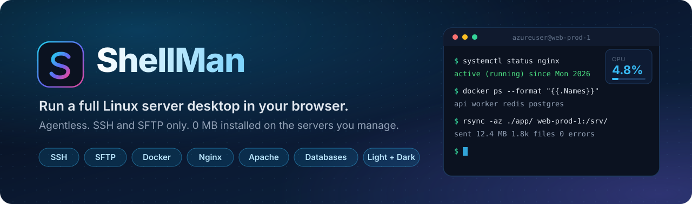
</p>

<p align="center">
  <a href="docs/deployment.md"></a>
  <a href="docs/deployment.md#option-a-1-command-docker-deployment-recommended"></a>
  <a href="docs/deployment.md#option-c-native-python-environment"></a>
  <a href="docs/features.md#sqlite-layer"></a>
  <a href="docs/features.md#pwa"></a>
  <a href="LICENSE"></a>
</p>

<p align="center">
  <a href="#what-is-shellman"><b>Overview</b></a> &nbsp;·&nbsp;
  <a href="#screenshots"><b>Screenshots</b></a> &nbsp;·&nbsp;
  <a href="#features-at-a-glance"><b>Features</b></a> &nbsp;·&nbsp;
  <a href="#quick-start"><b>Quick start</b></a> &nbsp;·&nbsp;
  <a href="#documentation"><b>Docs</b></a> &nbsp;·&nbsp;
  <a href="docs/security.md"><b>Security</b></a>
</p>

---

## What is ShellMan?

ShellMan is a **web desktop for managing Linux servers**. You run it on your own laptop, desktop or a private gateway, and it talks to your servers over plain **OpenSSH and SFTP**. Nothing is installed on them: no agent, no daemon, no extra open port. Disconnect and the server is exactly as you left it.

<p align="center">
  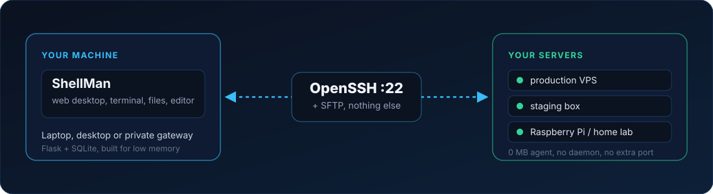
</p>

<table>
<tr>
<td width="33%" valign="top"><b>0 MB on your servers</b><br><sub>Your VPS keeps 100% of its RAM and CPU for your workloads.</sub></td>
<td width="33%" valign="top"><b>Port 22 only</b><br><sub>If SSH works, ShellMan works. No panel port to expose or scan.</sub></td>
<td width="33%" valign="top"><b>Many servers, one desktop</b><br><sub>Switch between production, staging and home lab from one node picker.</sub></td>
</tr>
</table>

> **Why not cPanel, Plesk, Webmin or Cockpit?** Those run a daemon on the server and often use 300 to 800 MB of RAM before your app even starts. ShellMan moves the interface to your side of the connection. [Read the full story and comparison](docs/why-shellman.md).

---

## Screenshots

<p align="center">
  <a href="docs/screenshots/desktop-overview.png"></a>
  <br><sub>The desktop: icons, live widgets, dock, node switcher and the light and dark toggle.</sub>
</p>

<table>
<tr>
<td width="50%" valign="top"><a href="docs/screenshots/file-manager-sftp.png"></a><br><b>SFTP file manager</b><br><sub>Per-type icons, bulk actions, custom actions panel. <a href="docs/features.md#file-manager">Details</a></sub></td>
<td width="50%" valign="top"><a href="docs/screenshots/code-workspace.png"></a><br><b>Code workspace</b><br><sub>Monaco editor, tree explorer and PTY terminal. <a href="docs/features.md#code-workspace">Details</a></sub></td>
</tr>
<tr>
<td width="50%" valign="top"><a href="docs/screenshots/fleet-light.png">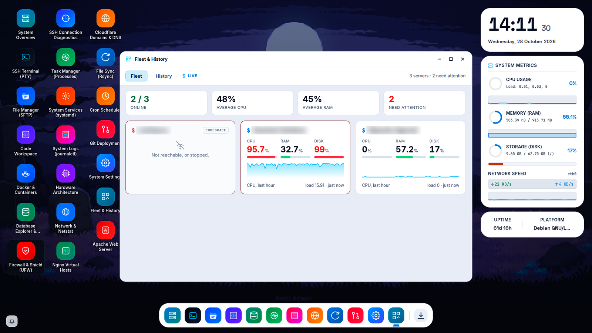</a><br><b>Fleet and History (light mode)</b><br><sub>All servers at a glance, with CPU, RAM and disk alerts. <a href="docs/features.md#fleet">Details</a></sub></td>
<td width="50%" valign="top"><a href="docs/screenshots/overview-light.png">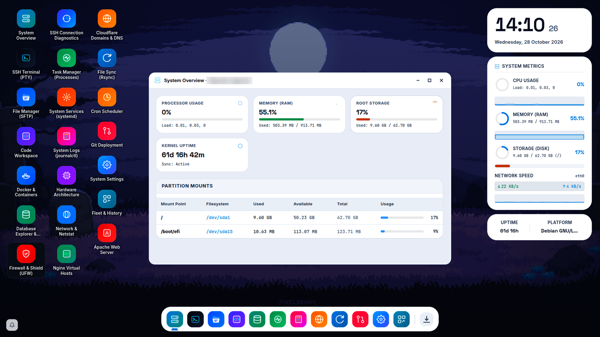</a><br><b>System Overview (light mode)</b><br><sub>Flat light theme with its own wallpaper. <a href="docs/features.md#theme">Details</a></sub></td>
</tr>
<tr>
<td width="50%" valign="top"><a href="docs/screenshots/cloudflare-and-databases.png">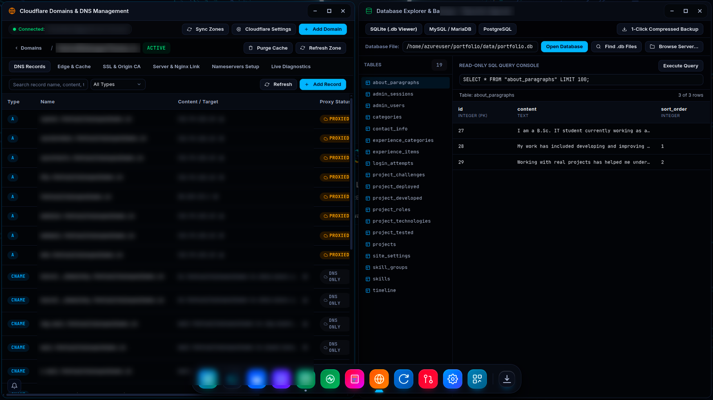</a><br><b>Cloudflare and database explorer</b><br><sub>DNS records, cache purge, and a read-only SQL console. <a href="docs/features.md#cloudflare">Details</a></sub></td>
<td width="50%" valign="top"><a href="docs/screenshots/netstat-and-services.png">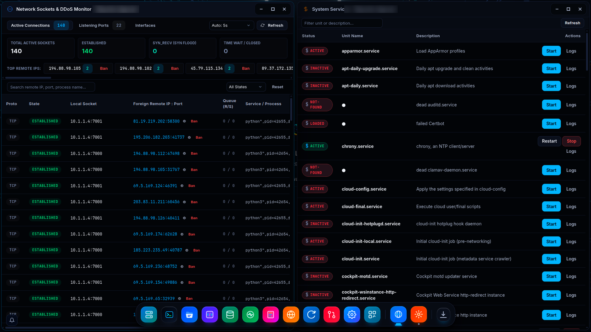</a><br><b>Network sockets and services</b><br><sub>Live sockets, listening ports and systemd control. <a href="docs/features.md#netstat">Details</a></sub></td>
</tr>
<tr>
<td width="50%" valign="top"><a href="docs/screenshots/settings-appearance.png">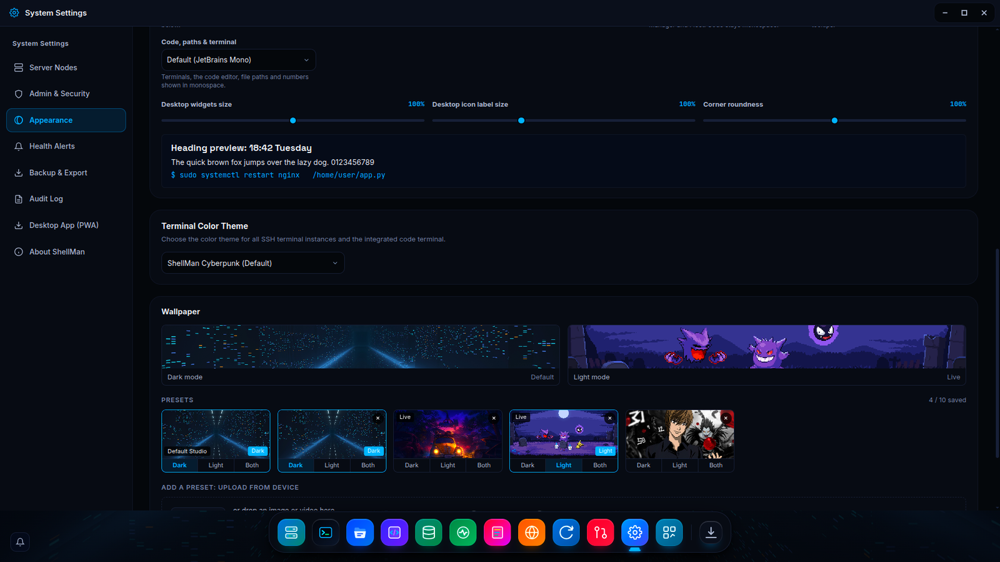</a><br><b>Wallpapers per theme</b><br><sub>Presets, uploads and live wallpapers, set for dark, light or both. <a href="docs/features.md#wallpapers">Details</a></sub></td>
<td width="50%" valign="top"><a href="docs/screenshots/git-and-sync.png">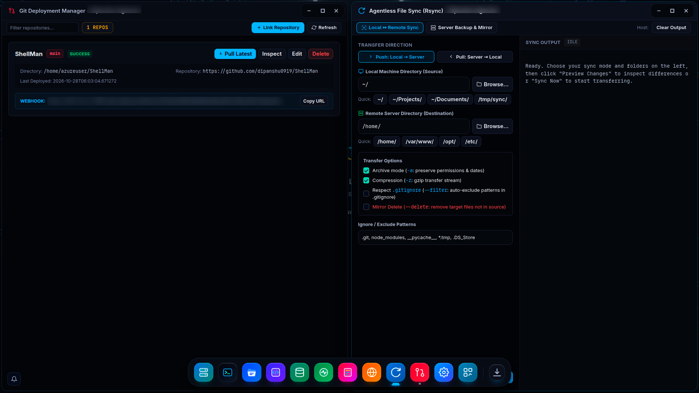</a><br><b>Git deployment and rsync</b><br><sub>Webhook deploys beside agentless rsync. <a href="docs/features.md#git-deploy">Details</a></sub></td>
</tr>
</table>

<details>
<summary><b>More screenshots</b></summary>
<br>

<table>
<tr>
<td width="50%" valign="top"><a href="docs/screenshots/health-alerts.png">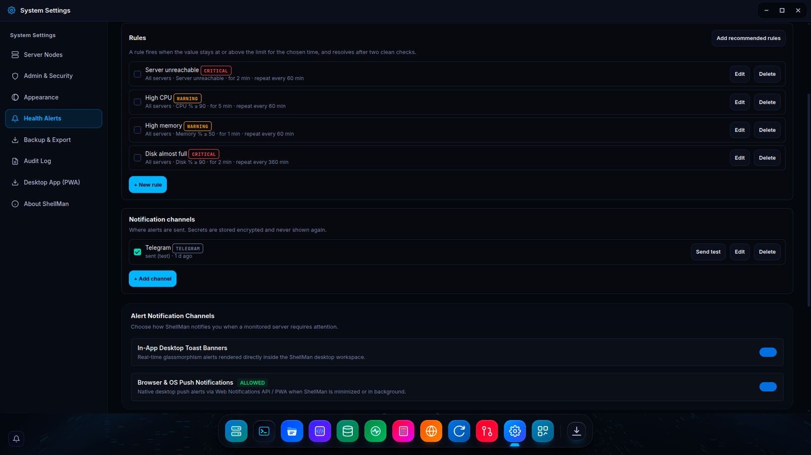</a><br><b>Health alerts</b><br><sub>Rules, notification channels and desktop toasts. <a href="docs/features.md#health-alerts">Details</a></sub></td>
<td width="50%" valign="top"><a href="docs/screenshots/audit-log.png">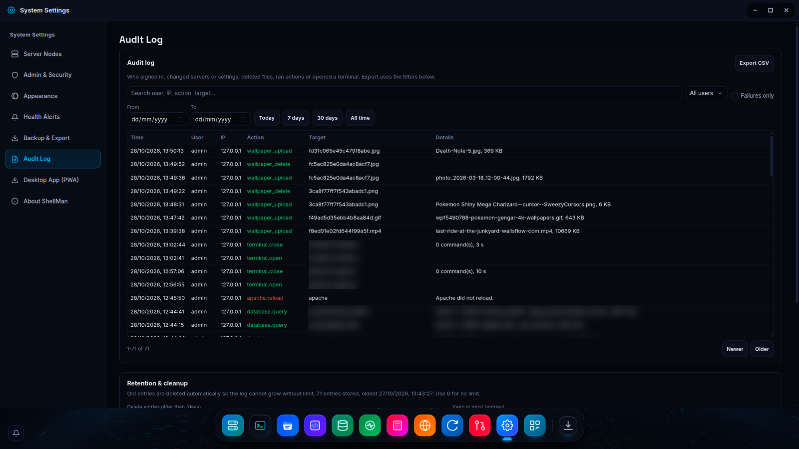</a><br><b>Audit log</b><br><sub>Searchable record of every change. <a href="docs/features.md#audit-log">Details</a></sub></td>
</tr>
<tr>
<td width="50%" valign="top"><a href="docs/screenshots/terminal-window.png"></a><br><b>SSH terminal</b><br><sub>Full PTY with xterm.js. <a href="docs/features.md#terminal">Details</a></sub></td>
<td width="50%" valign="top"><a href="docs/screenshots/database-and-processes.png"></a><br><b>Databases and task manager</b><br><sub>Query console, backups and process control. <a href="docs/features.md#databases">Details</a></sub></td>
</tr>
<tr>
<td width="50%" valign="top"><a href="docs/screenshots/system-logs.png"></a><br><b>Log viewer</b><br><sub>Live journalctl with filters. <a href="docs/features.md#services-logs">Details</a></sub></td>
<td width="50%" valign="top"><a href="docs/screenshots/file-compress.png">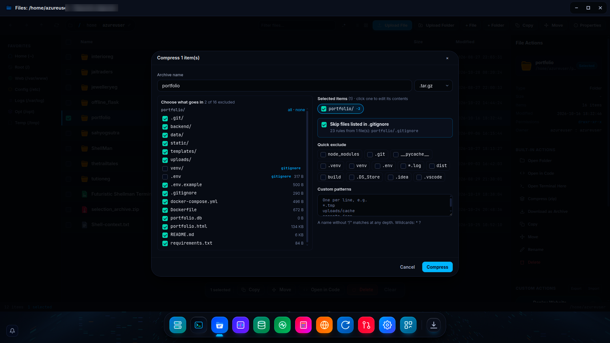</a><br><b>Compress dialog</b><br><sub>Choose contents, honor .gitignore, quick excludes. <a href="docs/features.md#file-manager">Details</a></sub></td>
</tr>
<tr>
<td width="50%" valign="top"><a href="docs/screenshots/admin-security.png">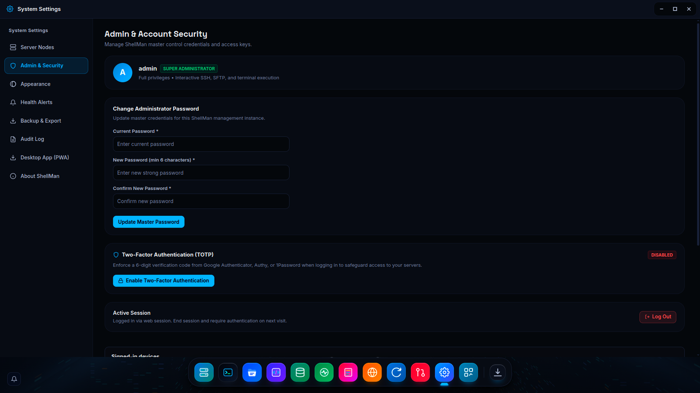</a><br><b>Account security</b><br><sub>Password, 2FA and signed-in devices. <a href="docs/features.md#two-factor">Details</a></sub></td>
<td width="50%" valign="top"><a href="docs/screenshots/settings-node-management.png"></a><br><b>Server nodes</b><br><sub>SSH credentials, keys and Codespaces. <a href="docs/features.md#desktop">Details</a></sub></td>
</tr>
</table>

</details>

---

## Features at a glance

Each feature name links to its full description in [docs/features.md](docs/features.md).

###  Workspace

| | Feature | What it gives you |
| :---: | :--- | :--- |
|  | **[Multi-window desktop](docs/features.md#desktop)** | Move, resize, snap and minimize windows to a dock, like a real OS. Switch servers from one node picker. |
|  | **[SSH terminal](docs/features.md#terminal)** | A real PTY over WebSockets with xterm.js, so vim, htop and tmux just work. Curated color themes. |
|  | **[SFTP file manager](docs/features.md#file-manager)** | Drag whole folders in, per-type file icons, compress with exclude rules, and reusable custom actions. |
|  | **[Code workspace](docs/features.md#code-workspace)** | Monaco (the VS Code editor) with tabs, a file tree, search and a built-in terminal. |
|  | **[Task manager](docs/features.md#task-manager)** | List processes and send SIGTERM, SIGKILL, SIGSTOP or SIGCONT, with RSS and PSS memory. |
|  | **[Services and logs](docs/features.md#services-logs)** | Control systemd units and stream journalctl live, with level filters and regex search. |
|  | **[Live telemetry](docs/features.md#telemetry)** | CPU, memory, disk, load and network widgets that follow the active server. |
|  | **[Netstat](docs/features.md#netstat)** | Live sockets plus a leaderboard of the noisiest remote IPs, with one-click ban. |

###  Web servers and domains

| | Feature | What it gives you |
| :---: | :--- | :--- |
|  | **[Nginx manager](docs/features.md#nginx)** | Virtual hosts, reverse proxies and Certbot SSL. Every save runs <code>nginx -t</code> and rolls back on failure. |
|  | **[Apache manager](docs/features.md#apache)** | Debian, RHEL and cPanel layouts: sites, config files, modules, logs and SSL. |
|  | **[Cloudflare](docs/features.md#cloudflare)** | Zones, DNS records and 15-year Origin CA certificates from one dashboard. |

###  Data and deployment

| | Feature | What it gives you |
| :---: | :--- | :--- |
|  | **[Database explorer](docs/features.md#databases)** | SQLite files, MySQL, MariaDB and PostgreSQL viewers with a query console and backups. |
|  | **[Docker](docs/features.md#docker)** | Containers, live logs and Compose up, down and restart. |
|  | **[File sync](docs/features.md#file-sync)** | Agentless rsync over SSH: push, pull or mirror, with dry-run previews. |
|  | **[Cron manager](docs/features.md#cron)** | Visual crontab with plain-English schedules and a Run Now tester. |
|  | **[Git deployment](docs/features.md#git-deploy)** | Pull on demand or on push through webhooks, then run post-deploy commands. |
|  | **[Fleet and history](docs/features.md#fleet)** | One page for every server, with CPU, memory and disk history up to 30 days. |

###  Security and operations

| | Feature | What it gives you |
| :---: | :--- | :--- |
|  | **[Firewall](docs/features.md#firewall)** | UFW rules and Fail2Ban jails, with one-click ban from the netstat view. |
|  | **[SSH diagnostics](docs/features.md#ssh-diagnostics)** | Latency, cipher, key exchange and host key details for each connection. |
|  | **[Two-factor sign-in](docs/features.md#two-factor)** | TOTP with a vector QR code and single-use recovery codes. |
|  | **[Audit log](docs/features.md#audit-log)** | Who signed in, changed settings, deleted files or ran a command, with CSV export. |
|  | **[Health alerts](docs/features.md#health-alerts)** | CPU, memory, disk and outage rules, sent to the desktop and to your channels. |
|  | **[Viewer accounts](docs/features.md#viewer-accounts)** | Read-only users for teammates. New features are closed to them by default. |
|  | **[Terminal recording](docs/features.md#recordings)** | Typed commands are logged per session. Output and passwords are never stored. |
|  | **[Encrypted backup](docs/features.md#encrypted-backup)** | One passphrase-encrypted file with servers, actions, rules and preferences. |

###  Look and feel

| | Feature | What it gives you |
| :---: | :--- | :--- |
|  | **[Light and dark](docs/features.md#theme)** | A flat, quiet light theme and the original dark one, switched with an animated toggle. |
|  | **[Wallpapers](docs/features.md#wallpapers)** | Up to 10 presets. Upload images, GIFs or videos and give dark and light mode their own. |
|  | **[Fonts and look](docs/features.md#fonts)** | Pick fonts, font scale, icon size and corner roundness. |
|  | **[Installable app](docs/features.md#pwa)** | Install it as a PWA and use it without browser chrome. |
|  | **[Widgets and layout](docs/features.md#widgets)** | Clock and resource widgets, dock customizer, ultrawide to phone layouts. |

---

## Quick start

**Docker** (recommended). Keys, server credentials and the SQLite database persist in the `shellman_data` volume:

```bash
docker run -d \
  -p 127.0.0.1:9874:9874 \
  -v shellman_data:/app/instance \
  --name shellman \
  --restart unless-stopped \
  dipanshu0919/shellman
```

**Python** (3.9+, with `openssh-client` and `rsync` installed):

```bash
git clone https://github.com/Dipanshu0919/ShellMan.git
cd ShellMan
python3 -m venv venv && source venv/bin/activate
pip install -r requirements.txt
python3 app.py
```

Open **http://127.0.0.1:9874**. On the first visit a **setup wizard** asks you to create the administrator account. ShellMan ships with **no default password**.

More options (Docker Compose, a public demo instance, first-run setup token) are in the [deployment guide](docs/deployment.md).

---

## Security in short

- **Nothing on the target.** No agent or listener means no extra attack surface on your servers.
- **Secrets are encrypted.** Server passwords, keys and API tokens are stored with Fernet; backups can be passphrase-encrypted.
- **Sign-in hardening.** TOTP 2FA with replay protection, brute-force lockout, same-site request checks and SSH host key pinning.
- **Least privilege.** Read-only viewer accounts, closed to new features by default, plus an audit log of every change.
- **Local by default.** `docker-compose.yml` publishes only on `127.0.0.1`. Put a TLS reverse proxy in front to expose ShellMan.

The complete list is in [docs/security.md](docs/security.md).

---

## Documentation

| Guide | What is in it |
| :--- | :--- |
| [Features](docs/features.md) | Every feature in detail: 38 sections from the desktop to wallpapers. |
| [Deployment](docs/deployment.md) | Docker, Docker Compose, native Python, first-run setup and a public demo. |
| [Cloudflare guide](docs/cloudflare.md) | Create a scoped API token, add domains, issue Origin CA certificates. |
| [Security](docs/security.md) | The full security architecture. |
| [Keyboard shortcuts](docs/shortcuts.md) | File manager and editor shortcuts. |
| [Why ShellMan](docs/why-shellman.md) | The story and a comparison with traditional panels. |

**Built with** Flask, Paramiko (SSH and SFTP), xterm.js, Monaco and Python's built-in `sqlite3`.

---

## License

ShellMan is released under the [MIT License](LICENSE). Use it, change it and deploy it for personal projects, team infrastructure or fleets.
